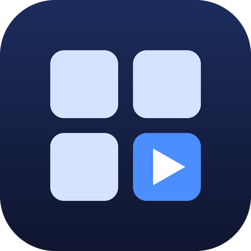

<p align="center"></p>

<h1 align="center">Atalhos PC</h1>

<p align="center"><b>Transforme um tablet ou celular Android em um painel de atalhos e numa mesa de sons para o Windows.</b><br>
Um toque no aparelho e o programa, arquivo ou pasta abre no computador, ou o som toca nas caixas do PC.</p>

<p align="center">
<a href="https://github.com/cavaleiro-ai/atalhos-pc/releases/latest/download/Instalar-AtalhosPC.exe"><b>⬇ Instalador para Windows</b></a> ·
<a href="https://github.com/cavaleiro-ai/atalhos-pc/releases/latest/download/AtalhosPC.apk"><b>⬇ App para Android (APK)</b></a> ·
<a href="https://github.com/cavaleiro-ai/atalhos-pc/releases/latest"><b>Todas as versões</b></a>
</p>

---

## O que ele faz

- **Abre qualquer coisa do PC pelo aparelho:** programa, documento, vídeo, pasta, atalho `.lnk` ou script. O que abre com dois cliques no Explorer abre aqui.
- **Mesmo ícone do Windows:** cada tecla mostra a logo do próprio arquivo, em alta resolução.
- **Visual de aparelho de verdade:** teclas em relevo que afundam e acendem em verde quando o arquivo abre, com várias páginas de atalhos.
- **Área de Sons:** pads iluminados que tocam sons nas caixas do PC, com volume por som, fader geral, medidor da saída real, mudo e parar.
- **Biblioteca de sons:** categorias, busca e prévia para uma coleção de áudios que você monta.
- **10 temas:** Grafite, Preto Absoluto, RGB Gamer, Neon Cyber, Matrix, Tron, Aurora, Vulcão, Ouro Negro e Gelo.
- **4 tamanhos de botão**, até 60 por página, e a opção de esconder os nomes e deixar só a logo.
- **USB, Wi-Fi ou Bluetooth**, com escolha automática.
- **Atalho na tela inicial:** qualquer tecla vira um ícone na tela inicial do Android.
- **Seguro:** só aparelhos pareados por código conversam com o PC, e o tráfego é cifrado.
- **Instalador para Windows:** um arquivo só, sem pedir senha de administrador, com desinstalação em **Aplicativos**.

> O aparelho é o controle: **o som sai nas caixas do PC, não no tablet**.

## Do que você precisa

| Lado | Requisito |
|---|---|
| Computador | Windows 8, 10 ou 11 (testado no 10). O .NET Framework 4.5 ou mais novo, que ele usa, já vem no Windows. |
| Aparelho | Tablet ou celular com Android 5.0 ou mais novo. |
| Ligação entre os dois | Um cabo USB, **ou** os dois no mesmo Wi-Fi, **ou** Bluetooth no PC. |

Não funciona em iPhone, iPad, Mac ou Linux.

---

## Instalação passo a passo

### 1. No computador

1. Baixe o **[Instalar-AtalhosPC.exe](https://github.com/cavaleiro-ai/atalhos-pc/releases/latest/download/Instalar-AtalhosPC.exe)** e dê dois cliques nele.
2. Se aparecer **"O Windows protegeu o computador"**, clique em **Mais informações** e em **Executar assim mesmo**. O aviso aparece porque o programa não tem assinatura digital paga.
3. Leia a saudação e clique em **Avançar**.
4. Deixe as opções como estão (pasta, atalhos na área de trabalho e no menu Iniciar) e clique em **Instalar**. Se quiser que o programa já abra quando o PC ligar, marque **Iniciar junto com o Windows**.
5. Na tela **Pronto!**, clique em **Concluir**. O programa abre.
6. Quando o Windows perguntar sobre a rede, clique em **Permitir acesso**. Sem isso, o tablet não encontra o PC. Se o aviso não aparecer, use o botão **Liberar no firewall do Windows** na janela do programa.

Fechar a janela no **X** não encerra o programa: ele continua no ícone perto do relógio. Para sair de vez, clique nesse ícone com o botão direito e em **Sair**.

**Prefere não instalar?** Baixe o **[AtalhosPC-portatil.zip](https://github.com/cavaleiro-ai/atalhos-pc/releases/latest/download/AtalhosPC-portatil.zip)**, extraia numa pasta fixa e abra o `AtalhosPC.exe`. Mantenha a pasta `sons` ao lado dele.

### 2. No tablet ou celular

1. No aparelho, abra este link no navegador: **[AtalhosPC.apk](https://github.com/cavaleiro-ai/atalhos-pc/releases/latest/download/AtalhosPC.apk)**. Ou copie o `AtalhosPC.apk` da pasta do programa no PC para o aparelho.
2. Toque no arquivo baixado. O Android pede para **permitir instalar apps desta fonte**: autorize o navegador (ou o app de arquivos) e volte.
3. Toque em **Instalar**. Se o Play Protect avisar que não conhece o app, toque em **Mais detalhes** e em **Instalar mesmo assim**.
4. Abra o **Atalhos PC**.

Quem usa depuração USB pode instalar pelo PC: `adb install -r AtalhosPC.apk`.

### 3. Ligar o aparelho ao PC

Escolha um caminho. O app tenta todos sozinho.

| Caminho | Como fazer |
|---|---|
| **Cabo USB (recomendado)** | Ligue o cabo e ative a **Ancoragem USB** no aparelho: `Configurações > Conexões > Roteador Wi-Fi e Ancoragem > Ancoragem USB`. O nome muda entre marcas, e o botão **Abrir Ancoragem USB** do app leva até lá. Em celular com plano de dados, o PC pode usar a internet do celular. |
| **Wi-Fi** | O PC e o aparelho precisam estar **no mesmo roteador**. Rede de convidados não funciona. Se o PC não aparecer, digite o IP que a janela do PC mostra. |
| **Bluetooth** | O PC precisa de adaptador Bluetooth. Pareie os dois nas configurações de Bluetooth e, no app, toque em **Mostrar PCs pareados por Bluetooth**. |

### 4. Parear (só uma vez)

1. No PC, clique em **Parear novo aparelho**. Aparece um código como `2S2-5M2`, válido por 3 minutos.
2. No app, toque em **Conectar ao PC**, escolha o PC e digite o código.

O pareamento impede que outra pessoa na mesma rede abra arquivos no seu computador.

### 5. Montar os atalhos

- **Pelo PC:** arraste arquivos, programas ou pastas para a janela do programa.
- **Pelo aparelho:** toque em **+ Adicionar**, navegue pelas pastas do PC e escolha o item.

Segure uma tecla para renomear, mover, criar um atalho na tela inicial ou remover. Em **Ajustes** você escolhe o tema, o tamanho dos botões e se os nomes aparecem.

### 6. Sons

Toque em **Sons** no topo do app. Os 11 sons de exemplo já vêm prontos. Para adicionar um seu, toque em **+ Adicionar** e escolha um áudio do PC, ou arraste o arquivo para a aba **Sons** da janela do PC. Use MP3, o formato testado.

### 7. Biblioteca de sons (opcional)

A biblioteca é uma pasta de áudios no PC que o app mostra por categoria, com busca e prévia. **Os áudios não vêm no download**, porque cada um deve usar sons que tem direito de usar. Para montar a sua:

```
%LOCALAPPDATA%\Programs\AtalhosPC\     (pasta do programa instalado)
├── AtalhosPC.exe
└── biblioteca\
    ├── Memes\             ← uma subpasta por categoria
    │   ├── som1.mp3
    │   └── som2.mp3
    ├── Memes.png          ← ícone da categoria (opcional)
    ├── Efeitos sonoros\
    └── Efeitos sonoros.png
```

Os ícones prontos estão em [`assets/icones-biblioteca`](assets/icones-biblioteca). Também dá para deixar a pasta em qualquer lugar e apontá-la no instalador, em **Copiar a biblioteca de sons**. Depois, abra a biblioteca pelo botão **Biblioteca…** no PC, ou em **Sons > + Adicionar > Biblioteca de sons** no aparelho.

O guia completo, com todas as telas, cores e problemas comuns, está em **[docs/GUIA-DE-USO.md](docs/GUIA-DE-USO.md)**.

---

## Problemas comuns

| Sintoma | O que fazer |
|---|---|
| O PC não aparece no app | Confira se o programa está aberto no PC e se a janela mostra `Firewall: liberado`. Confira se a Ancoragem USB está ligada ou se os dois estão no mesmo Wi-Fi. |
| A janela mostra `Firewall: falta liberar` | Clique em **Liberar no firewall do Windows** e confirme. |
| Funciona no cabo e não no Wi-Fi | Quase sempre são redes diferentes. Os três primeiros números do IP do PC e do aparelho costumam ser iguais, como `192.168.0.10` e `192.168.0.9`. |
| O app mostra **Parear de novo** | O aparelho foi removido no PC. Gere outro código e pareie. |
| O Android bloqueia a instalação do APK | Autorize a instalação pelo navegador ou pelo app de arquivos. |
| O pad não toca | O Windows não abriu o formato. Converta para MP3. |
| Não ouço nada | Confira o volume e a saída de áudio do Windows, e se o botão **Mudo** do app está aceso. |
| Erro no instalador | O motivo aparece na tela final, e o registro fica em `%TEMP%\AtalhosPC-instalador.log`. |

## Desinstalar

- **Do PC:** `Configurações > Aplicativos`, procure **Atalhos PC** e clique em **Desinstalar**. Seus atalhos e sons ficam guardados em `%APPDATA%\AtalhosPC`. Apague essa pasta se quiser remover tudo.
- **Do aparelho:** desinstale o app como qualquer outro.
- **Tirar o acesso de um aparelho:** no PC, selecione-o em **Aparelhos pareados** e clique em **Remover aparelho selecionado**.

---

## O que tem neste repositório

```
atalhos-pc/
├── dist/                        ← pronto para usar (as mesmas versões da página de Releases)
│   ├── Instalar-AtalhosPC.exe   instalador do Windows, já com o programa, o APK e os sons de exemplo
│   ├── AtalhosPC.exe            o programa do PC, para usar sem instalar
│   ├── AtalhosPC.apk            o app do Android
│   └── sons/                    11 sons de exemplo com ícones e LICENCAS.md
├── windows/                     código-fonte do lado do PC (C#)
│   ├── src/                     programa: janela, servidor, sons, ícones, protocolo
│   ├── setup/                   instalador e desinstalador
│   ├── tests/                   testes automáticos do protocolo e do instalador
│   └── build.ps1                compila tudo
├── android/                     código-fonte do app (Java, sem bibliotecas)
│   ├── src/                     telas, teclas, mixer, conexão e criptografia
│   ├── build.ps1                compila e assina o APK
│   └── setup-tools.ps1          baixa o JDK e as ferramentas do Android, se faltarem
├── assets/                      logo, ícones das categorias e scripts que geram ícones e sons
├── docs/
│   ├── GUIA-DE-USO.md           passo a passo completo para quem vai usar
│   ├── COMO-FUNCIONA.md         arquitetura, protocolo, segurança, instalador e compilação
│   └── O-QUE-FOI-FEITO.md       histórico das versões, testes e decisões
└── .claude/skills/atalhos-pc/   skill para o Claude Code instalar e configurar o app num aparelho
```

## Como funciona

```
Tablet / celular (app Android)                      PC (AtalhosPC.exe)
  teclas, pads e mixer                                 janela e ícone na bandeja
  conexão automática  ─── USB, Wi-Fi ou Bluetooth ───► servidor na porta 47810
  protocolo cifrado   ◄── ícones, lista, estado ─────  abre o arquivo como no Explorer
                                                       toca o som nas caixas do PC
```

- **Os três caminhos levam ao mesmo protocolo.** O Wi-Fi e a Ancoragem USB usam TCP na porta 47810, e o PC é achado por broadcast UDP. O USB por adb usa `adb reverse`. O Bluetooth usa RFCOMM.
- **Pareamento:** o código de 6 caracteres só existe depois de um clique no PC, vale 3 minutos e para um aparelho, e cai depois de 5 erros. Dele sai um segredo próprio de cada aparelho.
- **Tráfego:** cada mensagem é cifrada e autenticada, com proteção contra repetição. No PC, o segredo fica protegido pelo Windows (DPAPI).
- **Ícones:** o PC extrai a mesma imagem que o Explorer mostra e manda para o aparelho, que guarda em cache.
- **Sons:** tocados no PC pelo próprio Windows, com volume separado do sistema. O medidor lê a saída real de áudio.
- **Dados:** os atalhos, os sons e os pareamentos ficam no PC, em `%APPDATA%\AtalhosPC`. O tema e o tamanho ficam em cada aparelho.

**Cuidado:** quem tem um aparelho pareado pode abrir qualquer arquivo do PC com as permissões do seu usuário. Remova os aparelhos que não usa mais. Para limitar o aparelho à lista de atalhos, desligue **Permitir navegar** no PC.

Detalhes completos em **[docs/COMO-FUNCIONA.md](docs/COMO-FUNCIONA.md)**.

## Compilar do código-fonte

Não precisa de Visual Studio nem de Android Studio.

**Windows** (usa o `csc.exe` que já vem com o .NET Framework):

```powershell
powershell -ExecutionPolicy Bypass -File windows\build.ps1
windows\build\ProtocolTest.exe      # 90 testes do protocolo, sons e biblioteca
windows\build\InstaladorTest.exe    # 56 testes do instalador
```

O `dist\AtalhosPC.apk` precisa existir antes, porque vai dentro do instalador. Feche o programa antes de compilar.

**Android:**

```powershell
powershell -ExecutionPolicy Bypass -File android\setup-tools.ps1   # só na primeira vez: baixa ~310 MB de ferramentas oficiais
powershell -ExecutionPolicy Bypass -File android\build.ps1
```

A primeira compilação cria uma chave de assinatura nova (`android\atalhospc.keystore`). Ela não está no repositório. Por isso, um APK que você compilar não atualiza por cima do APK publicado aqui: desinstale o app antes de instalar o seu. Guarde a sua chave e nunca a publique.

## Skill para o Claude Code

A pasta [`.claude/skills/atalhos-pc`](.claude/skills/atalhos-pc) é uma skill que ensina o [Claude Code](https://claude.com/claude-code) a instalar o Atalhos PC, conferir a conexão e resolver problemas em qualquer tablet ou celular Android. Ela traz o instalador, o app, os sons e o código-fonte. Para usar, copie a pasta para `%USERPROFILE%\.claude\skills\` e peça, por exemplo, "instale o Atalhos PC no meu tablet".

## O que foi testado

Bancada: Galaxy Tab A8 (Android 14) e Windows 10 Pro.

| Item | Situação |
|---|---|
| USB por Ancoragem e por adb, pareamento, ícones, páginas, busca, reconexão, atalho na tela inicial | Testados no aparelho real |
| Som saindo no PC, volume por som e geral, mudo, parar, sons sobrepostos | Testados no aparelho real, medindo a saída de áudio do Windows |
| Temas, tamanhos, esconder nomes, ícone por emoji | Testados no aparelho real |
| Biblioteca de sons | Testada com 13.528 áudios, no PC e no tablet |
| Protocolo e ataques (código errado, mensagem adulterada, repetição, aparelho removido) | 90 testes automáticos |
| Instalador e desinstalador | 56 testes automáticos e testes de ponta a ponta: instalar, atualizar por cima e desinstalar |
| **Wi-Fi** | **Não testado de ponta a ponta.** Usa o mesmo código da Ancoragem USB, que funciona. |
| **Bluetooth** | **Não testado de ponta a ponta.** O PC da bancada não tem adaptador. |
| Outros aparelhos e versões do Android | Compila para Android 5.0+, mas só foi executado no Android 14. Celular foi simulado no tablet. |
| Formatos de áudio | MP3 testado. WAV, WMA, M4A e AAC dependem dos codecs do Windows. |

Se testar em outro aparelho, abra uma [issue](https://github.com/cavaleiro-ai/atalhos-pc/issues) contando como foi.

## Limites

- O programa do PC precisa estar aberto. A opção **Iniciar junto com o Windows** cuida disso.
- O som sai na saída de áudio padrão do Windows. O app não manda áudio do aparelho para o PC.
- A conexão fecha 30 segundos depois de sair do app, para poupar bateria, e volta sozinha ao abrir.
- O programa e o instalador não têm assinatura digital, então o SmartScreen avisa na primeira vez.

## Versões

| Parte | Versão |
|---|---|
| Programa do PC e instalador | 2.3 |
| App Android | 2.2 |

O histórico completo está em [docs/O-QUE-FOI-FEITO.md](docs/O-QUE-FOI-FEITO.md).

## Créditos

- **Sons de exemplo:** Wikimedia Commons, sob CC0, domínio público, CC BY e CC BY-SA. Autor e licença de cada um em [dist/sons/LICENCAS.md](dist/sons/LICENCAS.md).
- **Ícones dos sons e das categorias:** [Noto Emoji](https://github.com/googlefonts/noto-emoji), do Google, sob licença Apache 2.0.

---

<p align="center">Feito por <b>Cavaleiro AI</b>. Se o Atalhos PC te ajudou, siga <a href="https://www.instagram.com/cavaleiro.ai/"><b>@cavaleiro.ai</b></a> no Instagram.</p>
